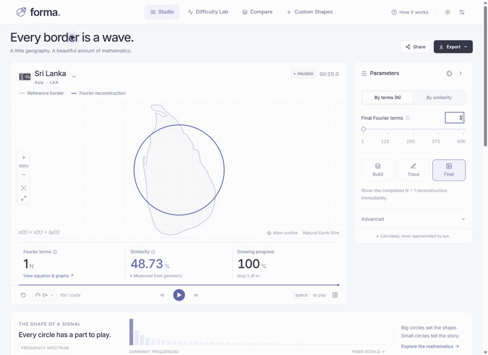
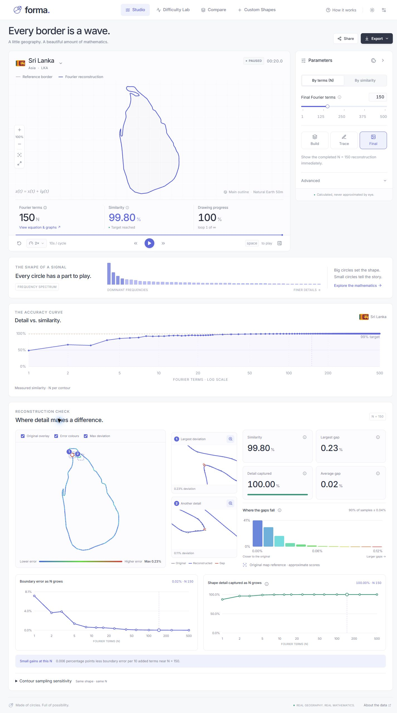
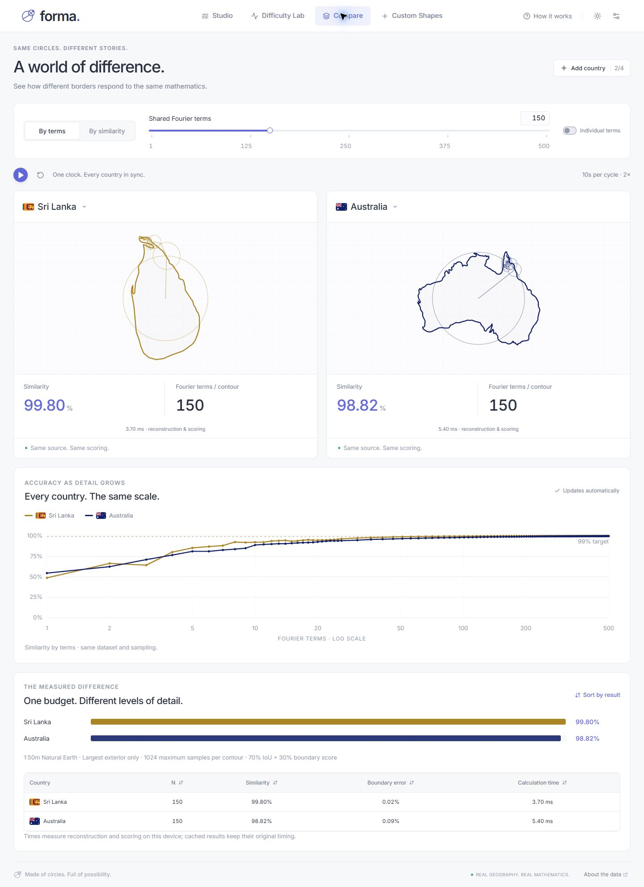
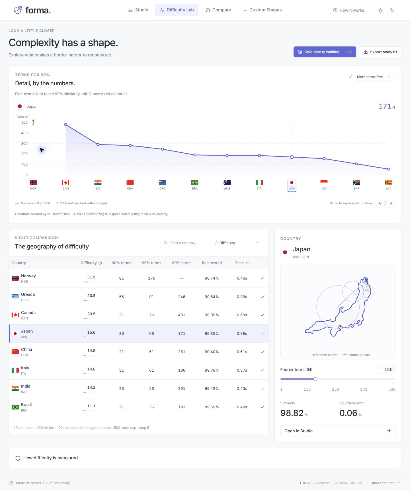
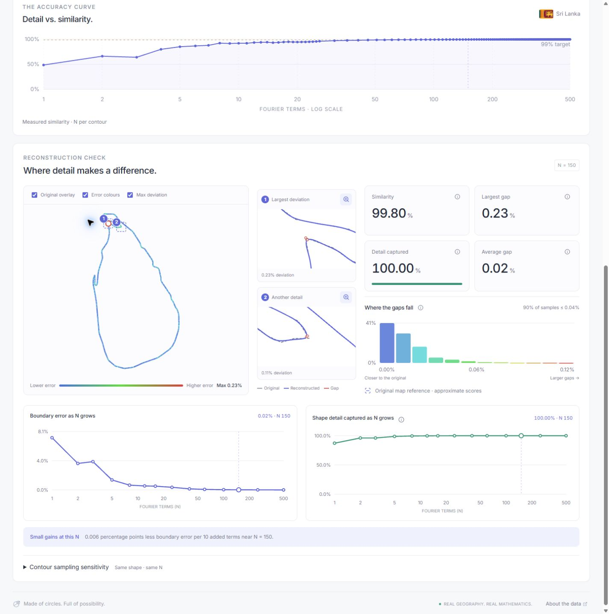

# Forma

**Country borders and custom shapes, rebuilt with Fourier series.**

[Try Forma](https://forma-borders.pamudu.chatgpt.site) · [GitHub Pages](https://maninka123.github.io/geofourier/) · [How it works](docs/MATHEMATICS.md)



Actual Studio frames · **N = 1 → 150**. [Still view](docs/screenshots/readme-studio-full.jpg).

| Studio · Build and inspect | Compare · Shared or individual N |
| --- | --- |
| [](docs/screenshots/readme-studio-full.jpg) | [](docs/screenshots/readme-compare-full.jpg) |
| **Difficulty Lab · Rank measured countries** | **Boundary checks · Locate errors and track convergence** |
| [](docs/screenshots/readme-lab-full.jpg) | [](docs/screenshots/readme-studio-full.jpg) |

Click a screenshot for the full page.

- **Custom shapes:** upload GeoJSON, SVG or CSV, or draw. Files stay in your browser; 2 MB limit.
- **Export:** PNG, SVG, WebM, JSON and CSV. Playback runs from 0.5× to 8×.
- **Measurements:** compare against the original map boundary. Scores approximate the dataset, not real-world coastline accuracy.

## Run locally

```sh
npm ci
npm run dev
```

`npm test` checks the calculations; `npm run build` creates `dist/`.

React · TypeScript · Vite · Canvas · Web Workers. No backend or API key.

Maps: [Natural Earth](https://github.com/nvkelso/natural-earth-vector), public domain. Flags: [FlagCDN](https://flagcdn.com/).
