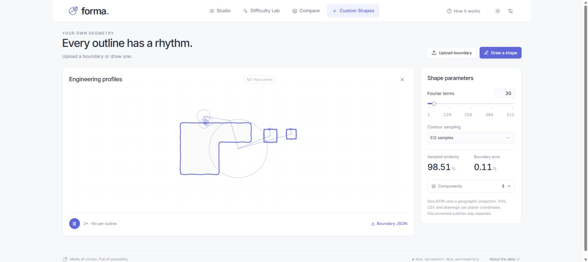

# Forma

**Country borders and custom shapes, drawn with Fourier series.**

[Open the live app](https://maninka123.github.io/geofourier/)



- **Studio:** animated construction, equations, boundary-error heatmap and close-ups, convergence and sampling checks.
- **Difficulty Lab:** all-country ranking, component counts, sortable calculation times and a visible time-cost contribution.
- **Compare:** shared or individual N, distinct flag colours, automatic accuracy curves and a sortable metrics table.
- **Custom Shapes:** GeoJSON, SVG, CSV or a drawing. Pen, polygon, eraser, undo and redo; disconnected outlines and holes stay separate.
- **Playback & export:** 2× by default, one speed control from 0.5× to 8×; PNG, SVG, WebM, JSON and CSV exports.
- **Settings:** restore defaults or clear calculated results after confirmation; presets and uploaded shapes are kept.

Uploads stay in your browser. Limits: **2 MB, 50,000 points, 128 separate areas**. Open paths require confirmation before closing. SVG and drawings retain screen orientation; CSV uses x,y or longitude,latitude headers. Land-area names appear where available.

```sh
npm ci
npm run dev
```

`npm test` checks the mathematics, imports and validation. `npm run build` produces `dist/`. Pushes to `main` test, build and deploy to GitHub Pages.

**Measurements:** similarity compares with the original boundary using overlap (70%) and closest-edge distance (30%). Difficulty combines term demand (70 points), border detail (20) and device-dependent calculation cost (10). Runs have no time limit by default. [Methods and limits](docs/MATHEMATICS.md).

**Built with:** React, TypeScript, Vite, Canvas and a Web Worker FFT engine. No backend or API key.

**Map data:** [Natural Earth](https://github.com/nvkelso/natural-earth-vector), public domain. 242 countries/territories at 1:50m, 177 at 1:110m. [Flags](https://flagcdn.com/).
