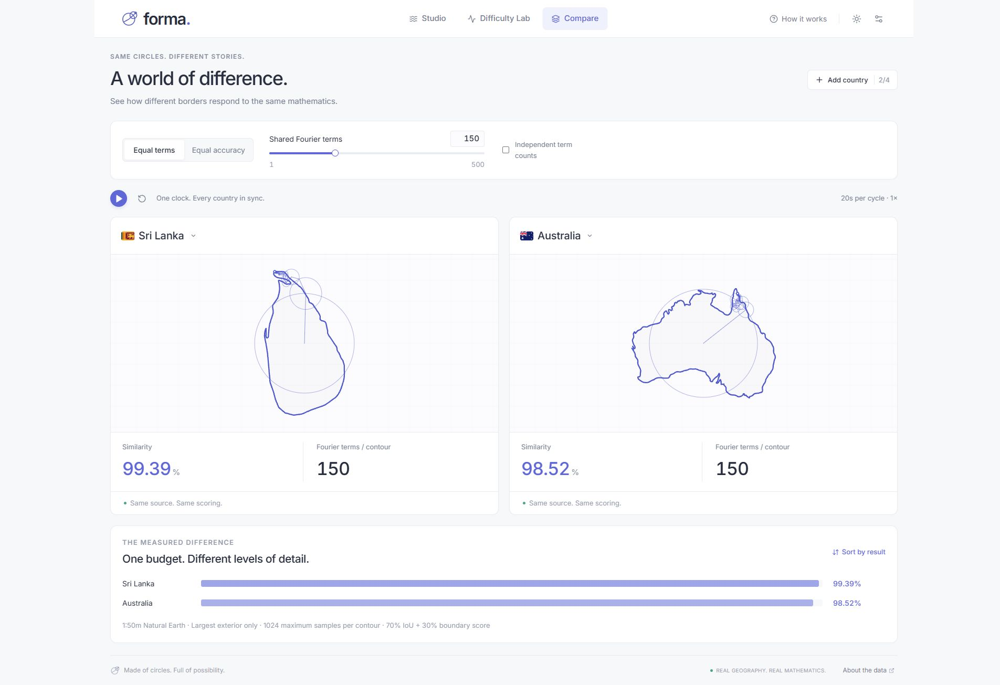

# Forma

**The mathematics of borders.** Real country outlines, reconstructed with rotating Fourier epicycles.

### [Open the live app ↗](https://maninka123.github.io/geofourier/)


| Difficulty Lab                                                      | Country Compare                                                     |
| ------------------------------------------------------------------- | ------------------------------------------------------------------- |
|  |  |

- **Studio:** choose N or target similarity; watch eight construction levels by default, trace at a fixed N, or show the final shape. Each construction level completes a loop; the final N keeps looping.
- **Equation explorer:** click the N statistic for the actual Fourier equation, animated x(t)/y(t) graphs, and coefficients displayed to two decimal places. [Preview](docs/screenshots/equation.jpg).
- **Difficulty Lab:** analyze one country, a starter set, or the entire dataset, with flag progress and locally cached results.
- **Compare:** two to four countries, equal terms or equal accuracy, with synchronized playback.
- **Export:** PNG, SVG, WebM, settings, coefficients, and measured CSV data. Shareable URLs and local presets included.

```sh
npm ci
npm run dev
```

`npm test` runs the mathematics and construction tests. `npm run build` produces the static app in `dist/`. Pushes to `main` test, build, and deploy through GitHub Actions to GitHub Pages.

**Built with:** React, strict TypeScript, Vite, Motion, Canvas 2D, and a Web Worker FFT engine. No backend or API key required.

**Data & scoring:** [Natural Earth](https://github.com/nvkelso/natural-earth-vector), public domain; 242 countries/territories at 1:50m and 177 at 1:110m. Similarity combines measured silhouette overlap (70%) and normalized bidirectional boundary distance (30%). [Mathematics and limitations →](docs/MATHEMATICS.md) Flags: [FlagCDN](https://flagcdn.com/).
